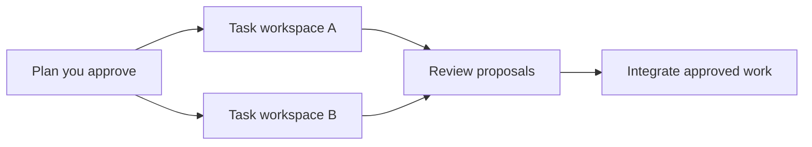

<h1 align="center">fold.</h1>

<p align="center"><strong>Build with parallel AI agents. Review and integrate in one place.</strong></p>

<p align="center">
  <a href="https://omukk.dev/fold">Website</a> ·
  <a href="https://www.youtube.com/watch?v=EKHyqm3N7Jo">Demo</a> ·
  <a href="#get-started">Get started</a> ·
  <a href="#how-it-works">How it works</a> ·
  <a href="https://github.com/omukkhq/fold/releases">Releases</a> ·
  <a href="https://github.com/omukkhq/fold/issues">Issues</a>
</p>

fold is a local-first development platform for individual developers and teams working with AI coding agents. Describe what you want in Claude Code, approve a plan, and let agents build and review the work in parallel. Follow progress, review changes, and make decisions from a live web interface.

We use fold to build and maintain our own projects.

## Why fold

- **Build in parallel.** Agents work in separate task workspaces. Task dependencies keep related work in order, and worker limits let you control concurrency.
- **Review the work as it happens.** Reviewers inspect proposals, run checks, fix what the task's scope settles as a new version of their own, and send back the work that the task still misses. New work outside the task becomes a request. The review lead can wait for related tasks and give them to one reviewer as a batch. Review proposals with diffs and inline comments, and ask an author about the lines you select. Select lines of a file in the repository, of a compare or of a proposal diff, and make a request about them: the main agent plans it with those lines in view. Each approval belongs to the version reviewed.
- **Bring approved changes together.** fold integrates ready proposals in dependency order. The approved proposals of a review batch integrate together, with one run of the integration checks. Changes that conflict return to their author for resolution.
- **Keep decisions with people.** Approve the plan before work starts, require human review where needed, and answer questions and tool permission requests in **Needs you** in the **Inbox**.
- **See the actual state.** The live board calculates task status from the work. Inspect running agents, their output, what they cost, proposals, and activity from the same application.
- **Keep a lasting project history.** Workspaces, checkpoints, reviews, and agent messages stay on your machine. Git integration connects the result to your existing repository and remotes.

## Get started

### Install fold

fold uses your installed Claude Code. Before you start, sign in to Claude Code version **2.1.299 or newer**. To use Git with a project, also install Git **2.36 or newer**. See the [Claude Code installation guide](https://code.claude.com/docs/en/overview#get-started).

Install fold on **Linux AMD64 (x86_64)**, **Linux ARM64 (aarch64)**, or **macOS 13 or newer with Apple silicon (ARM64)**. The Linux binaries are static and run on any distribution.

```bash
curl -fsSL https://omukk.dev/fold/install.sh | sh
```

The script installs `fld` into `~/.local/bin`. Run it again to update fold, then run `fld restart` so a running daemon uses the new version. When an update changes fold's skills, each agent that still holds the older skill is told on its next turn to load it again, and the **Agents** screen marks such a worker **older fold** until then. To choose another folder or a specific release, set `FOLD_INSTALL_DIR` or `FOLD_VERSION`, for example `FOLD_VERSION=v0.6.0`.

To uninstall fold, run:

```bash
curl -fsSL https://omukk.dev/fold/install.sh | sh -s -- --uninstall
```

On a terminal, the script asks before it removes each part: `fld` with the daemon's service, fold's entries in your Claude Code configuration, and fold's settings and data. Without a terminal, it removes only `fld` and the service. Each project's `.fold` folder stays. The script looks for `fld` in `~/.local/bin`, then on your `PATH`. If you installed it into another folder, set `FOLD_INSTALL_DIR` for the uninstaller too, for example `curl -fsSL https://omukk.dev/fold/install.sh | FOLD_INSTALL_DIR=/opt/fold/bin sh -s -- --uninstall`.

Check [Releases](https://github.com/omukkhq/fold/releases) for published binaries. You can also [build fold from source](CONTRIBUTING.md#build-from-source).

The `fld` binary includes the web application.

### Open a project

Create a new project:

```bash
fld init my-project
cd my-project
fld claude
```

Run `fld init` without a name to make the current folder a project. For an existing Git repository, run these commands from its root. Commit or stash pending changes first, and check out a branch.

```bash
fld init --with-git
fld claude
```

The first time you use fld on a device, it asks for the name that fold shows for you, and keeps it for every project. Set `FOLD_HUMAN` to use another name.

`fld init` adds fold's section to the project's agent instructions and fold's skills to the project: the `fold` skill and one skill for each agent role. `fld claude` and the daemon write those skills again whenever they differ from the ones of the installed fld; `fld init --refresh` also updates the section. The first `fld claude` or `fld setup` asks once to add the fold connection and hooks to your Claude Code user configuration. `fld claude` starts the daemon when needed and opens your main agent session. To start the daemon at login instead, run `fld setup` once: it installs a systemd user service on Linux and a launchd agent on macOS. Run `fld` alone to see the daemon's state, its version and web address, and the project of the current folder.

The **Projects** page lists the projects in fold, and a search by name, slug, or folder also finds the removed ones. **Remove** takes a project off fold while no worker of the project runs, and leaves its data in its folder; `fld claude`, `fld new`, or `fld init` in that folder, or **Add back** in the search, brings it back.

### Describe the work

Tell the main agent what you want to build, the constraints, and how you will check the result. For example:

> Build a small issue tracker with a web interface and an API. Include tests, plan independent tasks in parallel, and require my review before integration.

The main agent presents a plan for your approval, then starts the agents that build and review it.

To run a project on a server where nobody runs `fld claude`, set `supervised = true` under `[main]` in `.fold/config.toml`. fold then runs the main agent itself: it starts it with the daemon, and again for a message, a request, a ready main task, or a review that waits for it. The plan, the main agent's questions, and its changes to main come to you as messages in the web app, and fold refuses a main agent session in a terminal while the setting is on. The **Agents** screen stops it and starts it in a new session.

Run `fld web` and open the link it prints in your browser to follow the project at **127.0.0.1:7420**. The link signs you in once and works for a few minutes. Every browser needs a sign-in, also on your own machine, so a program cannot act as you by only naming you in a request. This keeps out the agents that fold starts. The main agent that you run with `fld claude` in your own terminal runs as you and can sign in as you. The browser sends the sign-in cookie to every port of the same address, so a local development server that you open in the same browser can receive it.

The top bar holds the project's tabs, the **Agents** control, the **Inbox**, **New task**, and your avatar menu. The **Proposals** and **Messages** tabs count in gold the proposals that wait for your review and the threads that wait for your answer. The **Agents** control shows the agents' live state and how many of them work, and its panel lists every agent and has **Pause**. The **Inbox** has two tabs. **Needs you** brings together questions, permissions, reviews, and other items that need your decision, in the groups **Agents ask you**, **Waiting for you**, and **Project**. **Updates** keeps the last ten card moves, one row for each task with a link to it. The avatar menu sets the light, dark, or system theme and has **Sign out**. Below a width of 1440 pixels, one menu holds the tabs, the agents' state with a link to the **Agents** screen and **Pause**, the theme, and **Sign out**.

The board shows tasks across **Backlog**, **To do**, **In progress**, **Review**, and **Done**. Each card shows one line about its work, and its details when you point at it or focus it. While a check run goes in a worker's workspace, its card says **Running checks**, for example **Running checks for v2** for the next version of its proposal. A worker that waits for its checks is not stalled, and its stall time counts from the end of the run. When cards change column, a short notice counts them per column, for example "3 cards moved to Review, 1 moved to Done", and names the task of a single move. A task opens in a dialog whose main column and side panel scroll on their own.

Every agent can ask you about its own work, and your reply in the web app goes back to it in the same thread; an agent that stopped meanwhile starts again for your reply. **Messages** shows the threads with you as a chat, with a search and a filter menu, whose button names its current choice, that shows **All threads**, **Waits for you**, **Questions**, or **Mine**, and narrows the list to an agent, a task, or a proposal. Enter sends a reply and Shift+Enter starts a new line, and each of your messages says whom it was delivered to and who read it. **Mark answered** closes an agent's question that you answered somewhere else, for example to the main agent, unless the agent waits for your reply.

A proposal's page has four tabs and one decision bar that stays at the top of each tab, with the buttons for your review, **Integrate**, and **Ask the author**; on a phone, your decisions sit in a bar at the bottom of the screen, with **Integrate** and **Ask the author** under **More**. **Overview** shows where its integration stands and the history of each version with its check runs and reviews. **Changes** shows the diff beside a folder tree of the changed files, and marks each file that you open as viewed. Between the changes, a row counts the unchanged lines that it hides: show 20 more lines up or down, or **Show all**. **Show whole file** at the head of a file shows every line of it, and **Show changes only** goes back. You can comment on the lines that you show. **Checks** shows every check run with the full log of each step. **Conversation** lists the proposal's threads. **Approve** and **Integrate** wait while fold runs the checks of the version or of its next version, and the page says why. Select lines in the diff to write a review comment or to ask the author about them, and use **Ask the author** in the decision bar for a question about the whole proposal. A review batch has its own page: **Merged changes** shows the change of all its members merged onto main, with the same unchanged lines to show, and **Integrate the batch** integrates its approved members when they are ready.

The **Cost** tab of the **Agents** screen shows what the project's agents cost today, in the last 7 days, and of all time, with their tokens, by role, area, model, task, and worker. A task's dialog shows its own cost, and the **Projects** page shows the cost of each project. The main agent session that you run with `fld claude` is not counted.

## How it works



1. **Plan.** Your main agent turns the goal into tasks, dependencies, and review requirements. You approve the scope before execution.
2. **Build.** Lead agents coordinate workers, each with a task and its own workspace. Workers submit their changes as proposals.
3. **Review.** The review lead gives each proposal to a reviewer agent, and can wait for related tasks so that one reviewer reviews them together as a batch. Reviewers inspect and test the proposals and fix what the task's scope settles themselves. Work that the task still misses goes back to the author, new work outside the task becomes a request, and product questions come to you. Tasks marked for human review also need your approval.
4. **Integrate.** By default, fold integrates approved proposals when their prerequisites are complete. The checks in the project's `fold-checks.toml` run on each proposal, at integration, or in both stages. The approved members of a review batch integrate together, with one run of the integration checks; when that run fails, fold integrates them one at a time. The project folder follows integrated main. When Git is on, each integration also creates a Git commit.

fold keeps its project data in `.fold/`. Agents build in workspaces under `.fold/ws/`; the project folder holds the integrated result. Checkpoints and persistent messages help agents continue work across sessions.

A project's history starts at the genesis revision `r0`: an empty tree, or the commit at `HEAD` of an existing Git repository. The files of a new project are your first change, `r1`.

## Change files yourself

You can edit the files in the project folder. fold does not overwrite a file you changed, and agents do not see your changes until you record them. While a file you changed is also changed on main, fold does not update the project folder until you record your changes or take them back:

```bash
fld record
```

`fld record` makes your changes one revision of main. If they conflict with the agents' work, they wait in **Needs you**, and the main agent helps you resolve them. When Git is on, a commit that you make yourself is recorded at once.

`.gitignore` and `.foldignore` keep files out of fold, as in Git: they apply only to files that main does not track yet. A file that main records stays tracked when a new ignore line matches it. To stop tracking it, add the line and run `fld untrack <path>`, like `git rm --cached`. One revision removes the file from main, and the file stays in your folder. Older revisions keep the file, so change any secret that main held.

## Work with Git

`fld init --with-git` turns Git on for a project, and Git stays on after that:

- In a Git repository, the commit at `HEAD` becomes the genesis, and the repository keeps its history.
- In a fold project or a new folder, fold creates the repository. If your Git configuration has no name and email, fold asks for them and keeps them in the repository's own configuration. `--git-name` and `--git-email` give them without the question.

When Git is on, every revision of main becomes a commit on the checked-out branch, with your Git identity as author and committer. Use fold's commands to connect a remote and exchange changes:

```bash
fld remote add origin <repository-url> [<branch>]
fld push
fld pull
```

Without a branch, fold uses the branch that the remote's `HEAD` names, or `main` when the remote is empty. A project that has no Git yet needs `fld init --with-git` first. When a project has more than one remote, give its name: `fld push <name>` or `fld pull <name>`. `fld remote list` shows the remotes, and `fld remote remove <name>` deletes one.

fold pushes without force. If incoming changes conflict, fold creates a sync task to resolve them through its task and review workflow.

## Get notices

fold can tell a webhook, a Slack channel or a Discord channel when something on a project changes: an item comes into Needs you, a card moves to Review or Done, a proposal is integrated, a check, an integration, a worker or Git fails, and more. Open the project's **Settings** tab in the web interface, or use `fld notify`:

```bash
fld notify add slack "Team Slack" --events recommended --moves-to review,done   # reads the URL from stdin
fld notify add webhook "Release bot" --events all <receiver-url>
fld notify web-url <address-people-open-fold-at>
fld notify test "Team Slack"
fld notify log "Release bot"
```

Each target selects its events and the board columns of its card moves. The notices of a target's window (15 seconds by default) go in one send. A generic webhook gets a JSON body signed with Standard Webhooks; fld prints its signing secret once. Slack and Discord get one message with a line per notice. A notice holds ids, titles, columns, names and links, never message text, review text or diffs. fold retries a failed send with the same `webhook-id` for about 8.6 hours. It turns a target off when a send fails all its tries, after 20 failed tries in a row, or at once when the receiver answers 410 Gone; a target fold turned off shows in Needs you with the reason, and a test that gets through turns it on again. Host targets (`--host`) apply to every project; `fld notify host-targets off` keeps a project to its own targets. Only a person can change targets, never an agent.

## Everyday commands

Run these commands inside your project:

| Command | Use it to |
| --- | --- |
| `fld claude` | Continue the last main agent session, or start one if needed. |
| `fld new` | Start a fresh main agent session. |
| `fld pause` | Stop project workers and keep their sessions. |
| `fld resume` | Resume workers stopped by a project pause. |
| `fld worker restart <name>` | Start a worker again in a new Claude Code session, for example when its session is broken. It keeps its name, claims and workers. |
| `fld record` | Record your own changes in the project folder on main. |
| `fld untrack <path>...` | Stop tracking files that main records and keep them in the project folder. A directory stands for every tracked file in it. Older revisions keep the files. |
| `fld stash` | Put your unrecorded changes aside, so the project folder follows main. `fld stash list` shows the stash. |
| `fld unstash` | Bring the newest stashed changes back into the project folder. If they conflict, fix the conflict markers, then run `fld record`. When an unstash stops part-way, the next `fld stash`, `fld unstash`, or `fld record` finishes it first. |
| `fld status` | See your project folder against main, like `git status`: the files `fld record` would record, the ones main changed too, what keeps the folder from following main with the next step for each, how many tracked files an ignore line matches (listed when one of them changed), and the stash with the entry `fld unstash` takes next. It changes nothing; `--json` prints the daemon's answer. |
| `fld setup` | Start the daemon at login. |
| `fld restart` | Restart the daemon after an update, so the new version takes over. Workers continue in their sessions. |
| `fld` | Show fold's own state: the version, whether the daemon runs and where, the service, and the current project. `fld status` shows the project folder instead. |
| `fld log` | List main's revisions, newest first: each revision's id and title, then its proposal, task and author or what kind of revision it is, and its time in your local time zone with its Git commit. `fld log -n 50` shows more, and `fld log --oneline` shows one line each. |
| `fld cost` | See what the project's agents cost and the tokens they used: the total of all time, today, and the last 7 days, by role, by area, and the top tasks. `--since`, `--by`, and `--task` narrow it, and `--json` prints the daemon's answer. |
| `fld doctor` | Check the installation, daemon, and projects, with suggested fixes. It names the running daemon and its version, says why workers cannot sign in, and repeats every problem with its fix at the end. |
| `fld transcript` | Find an agent's Claude Code transcript: `fld transcript <agent>` prints the path of the file of its current session, and `fld transcript <agent> --tail N` prints the file's last N lines. |
| `fld gc` | Delete objects that nothing refers to, prune old automatic checkpoints, remove the folder of a closed workspace that is still there, and prune the checkpoints of workspaces closed for longer than `closed_workspace_days` (14 days by default). fold removes a workspace's folder as soon as the workspace closes and its agent has no running worker and no open session, after a final checkpoint of the tracked files it had not recorded. That checkpoint is a record, not a restore point. `fld gc` retries a removal that failed. The daemon also runs it every day; `fld gc` needs a running daemon. `fld gc --dry-run` counts what a run would remove and changes nothing. |
| `fld web` | Print a one-time link that signs you in to the web interface. It works once, for a few minutes, and starts the daemon when needed. |
| `fld notify` | Send the project's events to webhooks, Slack or Discord: `fld notify list`, `add`, `edit`, `remove`, `test`, `log`, `rotate`, `web-url` and `host-targets`. See [Get notices](#get-notices). |
| `fld token` | Manage the tokens that sign a person in to the web interface from a browser that cannot open a link from `fld web`, such as one on another machine: `fld token create <username>`, `fld token list`, and `fld token revoke`. |
| `fld --help` | See the command reference. |

A project pause stops workers; approved proposals can still integrate.

## Help and contributions

Report bugs and request features through [GitHub Issues](https://github.com/omukkhq/fold/issues). For a bug report, include `fld --version`, your system, the full output of `fld doctor`, and the steps to reproduce it.

The GitHub repository is a read-only mirror. We accept code patches by email; [CONTRIBUTING.md](CONTRIBUTING.md) explains the process and the development setup.

Report security vulnerabilities privately through the process in [SECURITY.md](SECURITY.md).

## License

fold is licensed under the [GNU Affero General Public License v3.0 or later](LICENSE).
