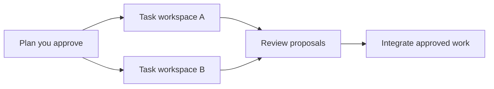

<h1 align="center">fold.</h1>

<p align="center"><strong>Build with parallel AI agents. Review and integrate in one place.</strong></p>

<p align="center">
  <a href="https://omukk.dev/fold">Website</a> ·
  <a href="https://www.youtube.com/watch?v=EKHyqm3N7Jo">Demo</a> ·
  <a href="#get-started">Get started</a> ·
  <a href="#how-it-works">How it works</a> ·
  <a href="https://github.com/omukkhq/fold/releases">Releases</a> ·
  <a href="https://github.com/omukkhq/fold/issues">Issues</a>
</p>

fold is a local-first development platform for individual developers and teams working with AI coding agents. Describe what you want in Claude Code, approve a plan, and let agents build and review the work in parallel. Follow progress, review changes, and make decisions from a live web interface.

We use fold to build and maintain our own projects.

## Why fold

- **Build in parallel.** Agents work in separate task workspaces. Task dependencies keep related work in order, and worker limits let you control concurrency.
- **Review the work as it happens.** Reviewers inspect proposals, run checks, fix what the task's scope settles as a new version of their own, and request changes for the rest. Review related proposals together, with diffs and inline comments. Each approval belongs to the version reviewed.
- **Bring approved changes together.** fold integrates ready proposals in dependency order. Changes that conflict return to their author for resolution.
- **Keep decisions with people.** Approve the plan before work starts, require human review where needed, and answer questions and tool permission requests in **Needs you**.
- **See the actual state.** The live board calculates task status from the work. Inspect running agents, their output, proposals, and activity from the same application.
- **Keep a lasting project history.** Workspaces, checkpoints, reviews, and agent messages stay on your machine. Git integration connects the result to your existing repository and remotes.

## Get started

### Install fold

fold uses your installed Claude Code. Before you start, sign in to Claude Code version **2.1.299 or newer**. To use Git with a project, also install Git **2.36 or newer**. See the [Claude Code installation guide](https://code.claude.com/docs/en/overview#get-started).

Install fold on **Linux AMD64 (x86_64)**, **Linux ARM64 (aarch64)**, or **macOS 13 or newer with Apple silicon (ARM64)**. The Linux binaries are static and run on any distribution.

```bash
curl -fsSL https://omukk.dev/fold/install.sh | sh
```

The script installs `fld` into `~/.local/bin`. Run it again to update fold, then run `fld restart` so a running daemon uses the new version. To choose another folder or a specific release, set `FOLD_INSTALL_DIR` or `FOLD_VERSION`, for example `FOLD_VERSION=v0.3.0`.

To uninstall fold, run:

```bash
curl -fsSL https://omukk.dev/fold/install.sh | sh -s -- --uninstall
```

On a terminal, the script asks before it removes each part: `fld` with the daemon's service, fold's entries in your Claude Code configuration, and fold's settings and data. Without a terminal, it removes only `fld` and the service. Each project's `.fold` folder stays. The script looks for `fld` in `~/.local/bin`, then on your `PATH`. If you installed it into another folder, set `FOLD_INSTALL_DIR` for the uninstaller too, for example `curl -fsSL https://omukk.dev/fold/install.sh | FOLD_INSTALL_DIR=/opt/fold/bin sh -s -- --uninstall`.

Check [Releases](https://github.com/omukkhq/fold/releases) for published binaries. You can also [build fold from source](CONTRIBUTING.md#build-from-source).

The `fld` binary includes the web application.

### Open a project

Create a new project:

```bash
fld init my-project
cd my-project
fld claude
```

Run `fld init` without a name to make the current folder a project. For an existing Git repository, run these commands from its root. Commit or stash pending changes first, and check out a branch.

```bash
fld init --with-git
fld claude
```

The first time you use fld on a device, it asks for the name that fold shows for you, and keeps it for every project. Set `FOLD_HUMAN` to use another name.

`fld init` adds fold's section to the project's agent instructions and the fold skill to the project. The first `fld claude` or `fld setup` asks once to add the fold connection and hooks to your Claude Code user configuration. `fld claude` starts the daemon when needed and opens your main agent session. To start the daemon at login instead, run `fld setup` once: it installs a systemd user service on Linux and a launchd agent on macOS. Run `fld` alone to see the daemon's state, its version and web address, and the project of the current folder.

The **Projects** page lists the projects in fold, and a search by name, slug, or folder also finds the removed ones. **Remove** takes a project off fold while no worker of the project runs, and leaves its data in its folder; `fld claude`, `fld new`, or `fld init` in that folder, or **Add back** in the search, brings it back.

### Describe the work

Tell the main agent what you want to build, the constraints, and how you will check the result. For example:

> Build a small issue tracker with a web interface and an API. Include tests, plan independent tasks in parallel, and require my review before integration.

The main agent presents a plan for your approval, then starts the agents that build and review it.

Open **[127.0.0.1:7420](http://127.0.0.1:7420)** in your browser to follow the project. The board shows tasks across **Backlog**, **Todo**, **In Progress**, **Review**, and **Done**. **Needs you** brings together questions, permissions, reviews, and other items that need your decision. **Messages** shows the threads with you, and **Mark answered** closes an agent's question that you answered somewhere else, for example to the main agent, unless the agent waits for your reply. The **Messages** and **Proposals** tabs count the threads and proposals that wait for you.

## How it works



1. **Plan.** Your main agent turns the goal into tasks, dependencies, and review requirements. You approve the scope before execution.
2. **Build.** Lead agents coordinate workers, each with a task and its own workspace. Workers submit their changes as proposals.
3. **Review.** Reviewer agents inspect and test the proposals and fix what the task's scope settles themselves. Product questions and larger changes go back to the author. Tasks marked for human review also need your approval.
4. **Integrate.** By default, fold integrates approved proposals when their prerequisites are complete. The project folder follows integrated main. When Git is on, each integration also creates a Git commit.

fold keeps its project data in `.fold/`. Agents build in workspaces under `.fold/ws/`; the project folder holds the integrated result. Checkpoints and persistent messages help agents continue work across sessions.

A project's history starts at the genesis revision `r0`: an empty tree, or the commit at `HEAD` of an existing Git repository. The files of a new project are your first change, `r1`.

## Change files yourself

You can edit the files in the project folder. fold does not overwrite a file you changed, and agents do not see your changes until you record them. While a file you changed is also changed on main, fold does not update the project folder until you record your changes or take them back:

```bash
fld record
```

`fld record` makes your changes one revision of main. If they conflict with the agents' work, they wait in **Needs you**, and the main agent helps you resolve them. When Git is on, a commit that you make yourself is recorded at once.

## Work with Git

`fld init --with-git` turns Git on for a project, and Git stays on after that:

- In a Git repository, the commit at `HEAD` becomes the genesis, and the repository keeps its history.
- In a fold project or a new folder, fold creates the repository. If your Git configuration has no name and email, fold asks for them and keeps them in the repository's own configuration. `--git-name` and `--git-email` give them without the question.

When Git is on, every revision of main becomes a commit on the checked-out branch, with your Git identity as author and committer. Use fold's commands to connect a remote and exchange changes:

```bash
fld remote add origin <repository-url> [<branch>]
fld push
fld pull
```

Without a branch, fold uses the branch that the remote's `HEAD` names, or `main` when the remote is empty. A project that has no Git yet needs `fld init --with-git` first. When a project has more than one remote, give its name: `fld push <name>` or `fld pull <name>`. `fld remote list` shows the remotes, and `fld remote remove <name>` deletes one.

fold pushes without force. If incoming changes conflict, fold creates a sync task to resolve them through its task and review workflow.

## Everyday commands

Run these commands inside your project:

| Command | Use it to |
| --- | --- |
| `fld claude` | Continue the last main agent session, or start one if needed. |
| `fld new` | Start a fresh main agent session. |
| `fld pause` | Stop project workers and keep their sessions. |
| `fld resume` | Resume workers stopped by a project pause. |
| `fld worker restart <name>` | Start a worker again in a new Claude Code session, for example when its session is broken. It keeps its name, claims and workers. |
| `fld record` | Record your own changes in the project folder on main. |
| `fld stash` | Put your unrecorded changes aside, so the project folder follows main. `fld stash list` shows the stash. |
| `fld unstash` | Bring the newest stashed changes back into the project folder. If they conflict, fix the conflict markers, then run `fld record`. |
| `fld setup` | Start the daemon at login. |
| `fld restart` | Restart the daemon after an update, so the new version takes over. Workers continue in their sessions. |
| `fld` | Show fold's status: the version, whether the daemon runs and where, the service, and the current project. |
| `fld log` | List main's revisions, newest first: `fld log -n 50` shows more, and `fld log --oneline` shows one line each. |
| `fld doctor` | Check the installation, daemon, and projects, with suggested fixes. It names the running daemon and its version, says why workers cannot sign in, and repeats every problem with its fix at the end. |
| `fld transcript` | Find an agent's Claude Code transcript: `fld transcript <agent>` prints the path of the file of its current session, and `fld transcript <agent> --tail N` prints the file's last N lines. |
| `fld gc` | Delete objects that nothing refers to, prune old automatic checkpoints, remove the folder of a closed workspace that is still there, and prune the checkpoints of workspaces closed for longer than `closed_workspace_days` (14 days by default). fold removes a workspace's folder as soon as the workspace closes and its agent has no running worker and no open session, after a final checkpoint of the tracked files it had not recorded. That checkpoint is a record, not a restore point. `fld gc` retries a removal that failed. The daemon also runs it every day; `fld gc` needs a running daemon. `fld gc --dry-run` counts what a run would remove and changes nothing. |
| `fld token` | Manage the tokens that sign a person in to the web interface off localhost: `fld token create`, `fld token list`, and `fld token revoke`. |
| `fld --help` | See the command reference. |

A project pause stops workers; approved proposals can still integrate.

## Help and contributions

Report bugs and request features through [GitHub Issues](https://github.com/omukkhq/fold/issues). For a bug report, include `fld --version`, your system, the full output of `fld doctor`, and the steps to reproduce it.

The GitHub repository is a read-only mirror. We accept code patches by email; [CONTRIBUTING.md](CONTRIBUTING.md) explains the process and the development setup.

Report security vulnerabilities privately through the process in [SECURITY.md](SECURITY.md).

## License

fold is licensed under the [GNU Affero General Public License v3.0 or later](LICENSE).
