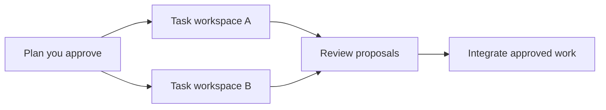

<h1 align="center">fold.</h1>

<p align="center"><strong>Build with parallel AI agents. Review and integrate in one place.</strong></p>

<p align="center">
  <a href="#get-started">Get started</a> ·
  <a href="#how-it-works">How it works</a> ·
  <a href="https://github.com/omukkhq/fold/releases">Releases</a> ·
  <a href="https://github.com/omukkhq/fold/issues">Issues</a>
</p>

fold is a local-first development platform for individual developers and teams working with AI coding agents. Describe what you want in Claude Code, approve a plan, and let agents build and review the work in parallel. Follow progress, review changes, and make decisions from a live web interface.

We use fold to build and maintain our own projects.

## Why fold

- **Build in parallel.** Agents work in separate task workspaces. Task dependencies keep related work in order, and worker limits let you control concurrency.
- **Review the work as it happens.** Reviewers inspect proposals, run checks, and request changes. Review related proposals together, with diffs and inline comments. Each approval belongs to the version reviewed.
- **Bring approved changes together.** fold integrates ready proposals in dependency order. Changes that conflict return to their author for resolution.
- **Keep decisions with people.** Approve the plan before work starts, require human review where needed, and answer questions and tool permission requests in **Needs you**.
- **See the actual state.** The live board calculates task status from the work. Inspect running agents, their output, proposals, and activity from the same application.
- **Keep a lasting project history.** Workspaces, checkpoints, reviews, and agent messages stay on your machine. Git integration connects the result to your existing repository and remotes.

## Get started

### Install fold

fold uses your installed Claude Code. Before you start, install Git and sign in to Claude Code version **2.1.299 or newer**. See the [Claude Code installation guide](https://code.claude.com/docs/en/overview#get-started).

Install fold on **Linux AMD64 (x86_64)**, **Linux ARM64 (aarch64)**, or **macOS 13 or newer with Apple silicon (ARM64)**. The Linux binaries are static and run on any distribution.

```bash
curl -fsSL https://omukk.dev/fold/install.sh | sh
```

The script installs `fld` into `~/.local/bin`. Run it again to update fold. To choose another folder or a specific release, set `FOLD_INSTALL_DIR` or `FOLD_VERSION`, for example `FOLD_VERSION=v0.1.0`.

Check [Releases](https://github.com/omukkhq/fold/releases) for published binaries. You can also [build fold from source](CONTRIBUTING.md#build-from-source).

The `fld` binary includes the web application.

### Open a project

For an existing Git repository, run these commands from its root. Commit or stash pending changes first, and check out a branch.

```bash
fld init --from-git
fld claude
```

Or create a new project:

```bash
fld init my-project
cd my-project
fld claude
```

`fld init` adds the fold connection, skill, and hooks to your project's Claude Code configuration. `fld claude` starts the daemon when needed and opens your main agent session. To start the daemon at login instead, run `fld setup` once: it installs a systemd user service on Linux and a launchd agent on macOS.

### Describe the work

Tell the main agent what you want to build, the constraints, and how you will check the result. For example:

> Build a small issue tracker with a web interface and an API. Include tests, plan independent tasks in parallel, and require my review before integration.

The main agent presents a plan for your approval, then starts the agents that build and review it.

Open **[127.0.0.1:7420](http://127.0.0.1:7420)** in your browser to follow the project. The board shows tasks across **Backlog**, **Todo**, **In Progress**, **Review**, and **Done**. **Needs you** brings together questions, permissions, reviews, and other items that need your decision.

## How it works



1. **Plan.** Your main agent turns the goal into tasks, dependencies, and review requirements. You approve the scope before execution.
2. **Build.** Lead agents coordinate workers, each with a task and its own workspace. Workers submit their changes as proposals.
3. **Review.** Reviewer agents inspect and test the proposals. Requested changes go back to the author. Tasks marked for human review also need your approval.
4. **Integrate.** By default, fold integrates approved proposals when their prerequisites are complete. The project folder follows integrated main, and each integration creates a Git commit.

fold keeps its project data in `.fold/`. Agents build in workspaces under `.fold/ws/`; the project folder holds the integrated result. Checkpoints and persistent messages help agents continue work across sessions.

## Work with Git

An existing repository keeps its history when you initialize it with `fld init --from-git`. Use fold's commands to connect a remote and exchange changes:

```bash
fld remote set origin <repository-url> <branch>
fld push
fld pull
```

fold pushes without force. If incoming changes conflict, fold creates a sync task to resolve them through its task and review workflow.

## Everyday commands

Run these commands inside your project:

| Command | Use it to |
| --- | --- |
| `fld claude` | Continue the last main agent session, or start one if needed. |
| `fld new` | Start a fresh main agent session. |
| `fld pause` | Stop project workers and keep their sessions. |
| `fld resume` | Resume workers stopped by a project pause. |
| `fld setup` | Start the daemon at login. |
| `fld doctor` | Check the installation, daemon, and projects, with suggested fixes. |
| `fld --help` | See the command reference. |

A project pause stops workers; approved proposals can still integrate.

## Help and contributions

Report bugs and request features through [GitHub Issues](https://github.com/omukkhq/fold/issues). For a bug report, include `fld --version`, your system, and the steps to reproduce it. `fld doctor` can help identify setup problems.

The GitHub repository is a read-only mirror. We accept code patches by email; [CONTRIBUTING.md](CONTRIBUTING.md) explains the process and the development setup.

Report security vulnerabilities privately through the process in [SECURITY.md](SECURITY.md).

## License

fold is licensed under the [GNU Affero General Public License v3.0 or later](LICENSE).
